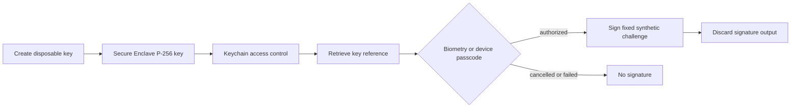

# iOS device-bound key access spike

PR 04 adds a removable test harness for a device-generated Secure Enclave
P-256 signing key. The key is synthetic. The app signs a fixed test challenge
only after retrieving the protected key through Keychain Services; it displays
status text and discards the signature. It does not display or persist account
data or a TOTP seed.

## Candidate access policy

The experiment creates the key with:

- `kSecAttrTokenIDSecureEnclave`, so the private key is created for the Secure
  Enclave and is not exported to app memory.
- `kSecAttrAccessibleWhenPasscodeSetThisDeviceOnly`, requiring a device
  passcode and restricting the item to its creating device.
- `userPresence` and `privateKeyUsage` access-control flags. `userPresence`
  permits either biometry or the device passcode; Keychain Services invokes
  Local Authentication when the app retrieves the key. `privateKeyUsage` is
  required for signing operations on the protected key.

This is a candidate local-unlock boundary, not a production credential-vault
design. Secure Enclave keys are created on-device, are limited to P-256
operations, and cannot import a pre-existing symmetric TOTP seed. A future
vault design must separately decide how to encrypt stored credentials and how
to recover them across device changes.

The harness stores only a random Keychain application tag in `UserDefaults` so
it can find the test key after relaunch. Use **Delete synthetic key** after
testing. Do not use this harness with real secrets.

## Key flow



No software-key fallback is created when Secure Enclave key generation fails.
The Face ID usage string describes only this disposable signing experiment.

## Platform evidence

| Case | Documented behavior or observation |
| --- | --- |
| Secure Enclave simulator support | The iPhone 17 Pro simulator built and launched the harness. Key creation failed, and the UI confirmed no fallback key was made. This is a simulator limitation, not evidence of physical-device behavior. |
| Physical device, iOS 27.2.1 (build 24B156) | On 18 November 2026, the locally signed harness created a synthetic Secure Enclave P-256 key on an iPhone. After Face ID, the app displayed “Protected signing succeeded. Signature output was discarded.” The app was signed with a Personal Team profile for this test; the repository's Xcode project signing configuration was restored afterward. |
| Unsuccessful authentication/signing attempt | A second attempt made without successful Face ID returned “The protected signing operation failed.” No signature was produced. The user did not confirm tapping the system prompt's Cancel control, so the explicit cancel-button result remains unverified. |
| Key cleanup | The user reported that **Delete synthetic key** completed. The app was uninstalled after the first run. It was later reinstalled for the passcode-fallback check; that check is still pending and no key has been recreated. |
| Passcode fallback | Not yet exercised. The physical run demonstrated Face ID only. |
| No device passcode | Apple documents that `WhenPasscodeSetThisDeviceOnly` items cannot be created without a passcode. Not exercised on hardware. |
| Passcode removal or change | Apple documents that removing the passcode deletes items in this accessibility class. Neither removal nor change was performed. |
| Biometric enrollment change | Not tested. The chosen `userPresence` policy allows passcode fallback; this spike makes no claim that a biometric-set change invalidates the key. |
| Device lock, app background, process death, relaunch | Not tested with a successfully created Secure Enclave key. The random application tag is retained to support a relaunch check on hardware. |
| Screen redaction | The harness never displays the key, challenge bytes, or signature. Production screens must replace sensitive views when the scene becomes inactive, before iOS captures an app-switcher snapshot. Screen-capture state should also be observed where supported. |

The physical run demonstrated successful Face ID-gated signing, a non-successful
signing attempt, and key cleanup. Passcode fallback and the explicit Cancel
control remain unverified, so the PR stays a draft until passcode fallback is
exercised. Destructive passcode or biometric-change cases remain untested and
must not be inferred from simulator results.

## Reproduce the simulator check

On macOS with Xcode 26.6 and Rust 1.99.0:

```sh
./scripts/build-rust-ios.sh
xcodegen generate --spec apps/ios/project.yml --project apps/ios
xcodebuild -project apps/ios/AuthenticatorSpike.xcodeproj \
  -scheme AuthenticatorSpike \
  -destination 'platform=iOS Simulator,name=iPhone 17 Pro,OS=26.3.1' build
```

Launch the app and select **Create synthetic key**. The simulator reports that
Secure Enclave key creation failed and does not enable the signing action. This
confirms the app does not silently fall back to a software key; it does not
prove hardware-backed key use.

## Apple references

- [Accessing Keychain Items with Face ID or Touch ID](https://developer.apple.com/documentation/localauthentication/accessing-keychain-items-with-face-id-or-touch-id)
- [SecAccessControlCreateFlags](https://developer.apple.com/documentation/security/secaccesscontrolcreateflags)
- [kSecAttrAccessibleWhenPasscodeSetThisDeviceOnly](https://developer.apple.com/documentation/security/ksecattraccessiblewhenpasscodesetthisdeviceonly)
- [Protecting keys with the Secure Enclave](https://developer.apple.com/documentation/security/protecting-keys-with-the-secure-enclave)
- [Preparing your UI to run in the background](https://developer.apple.com/documentation/uikit/preparing-your-app-to-run-in-the-background)
